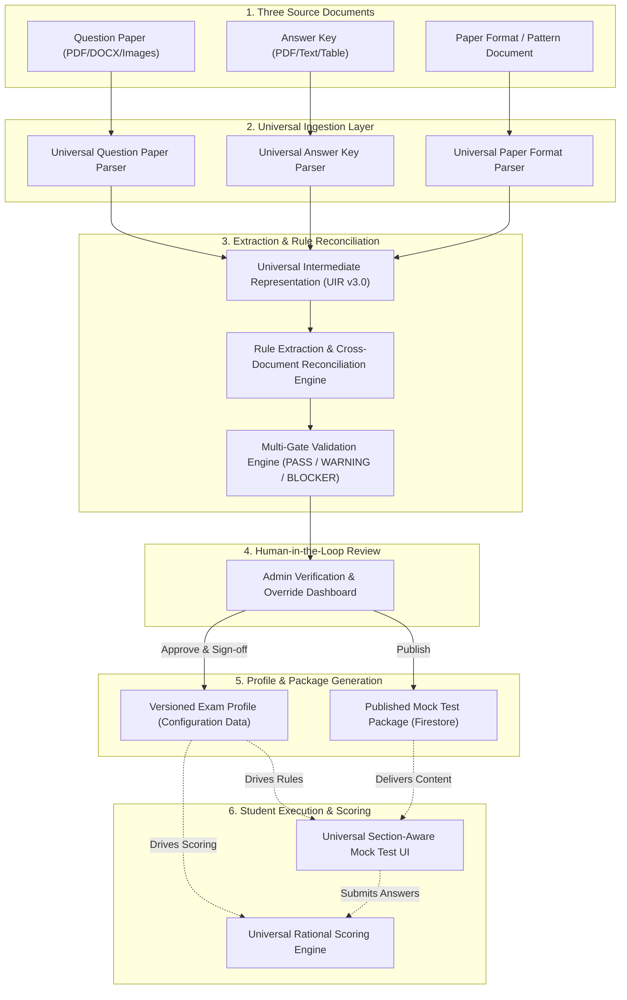
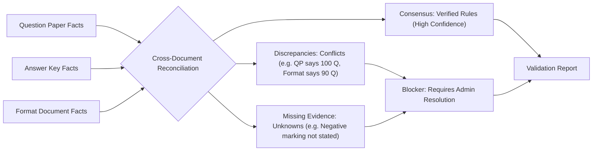
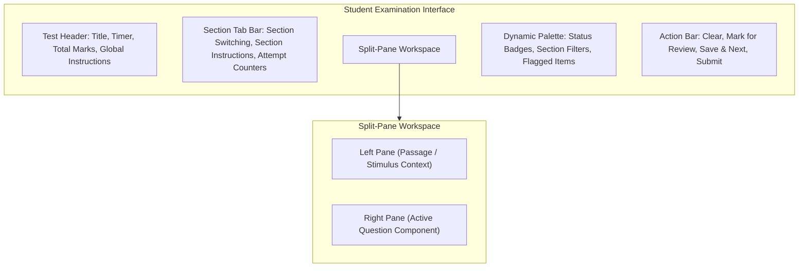

# Universal Document-Driven Mock Test Pipeline Architecture Specification

**Specification Version:** 3.0.0  
**Status:** Approved Architectural Blueprint  
**Repository:** `C:\Users\RUPENDRA\Documents\VidyarthiAstra-current`  
**Governing Principle:** *The documents and approved configuration are the source of exam-specific data. The application code is the universal engine.*

---

## 1. Architectural Vision & Scope

The objective of the Universal Document-Driven Mock Test Pipeline is to onboard and execute **any examination** without modifying application source code, writing exam-specific conditional statements, or creating hardcoded scoring rules.

The system ingests three user-provided artifacts:
1. **Original Question Paper (QP):** Digital or scanned PDF, DOCX, or images containing questions, diagrams, instructions, and section headers.
2. **Official Answer Key (AK):** PDF, text, or tabular document declaring official correct options, numerical answers, multiple accepted choices, or dropped questions.
3. **Official Paper Format / Pattern Document (PF):** Official notification, syllabus, information bulletin, or instructions sheet defining duration, maximum marks, section structure, question types, optional question rules, and marking schemes.

Through automated parsing, multi-document cross-verification, and an administrative review gate, the pipeline produces a normalized, immutable **Exam Profile Configuration** and a fully functioning mock test.



---

## 2. Ingestion Layer Specification

The ingestion system accepts three documents and provides standardized output streams regardless of file format.

### 2.1 Universal Question Paper Parser (UQPP)

#### Responsibilities:
- **Structural Boundary Detection:**
  - Extracts overall paper instructions, duration, and maximum marks from front pages.
  - Identifies section breaks (e.g. "Section A: Physics", "Part I: Quantitative Aptitude", "General Studies").
  - Identifies question boundaries using dynamic typographic, spatial, and linguistic indicators rather than hardcoded ranges.
- **Content & Formula Reconstruction:**
  - Preserves mathematical notation (LaTeX representation, super/subscripts, fractions, radicals, Greek symbols).
  - Preserves tables and tabular choices.
  - Extracts embedded vector and raster diagrams via `DiagramExtractionService`, attaching coordinate-linked assets.
- **Multilingual Support:**
  - Detects bilingual or interleaved papers (e.g. English + Hindi, regional languages).
  - Preserves primary language content while linking translated stems where present.
- **Scanned Document OCR:**
  - When text layer is absent or sparse (< 50 characters per page), routes page images through an OCR pipeline that preserves bounding boxes, question stems, and option labels.

### 2.2 Universal Answer Key Parser (UAKP)

#### Responsibilities:
- **Agnostic Structure Identification:**
  - Parses multi-column tables, dense lists (e.g. `14 B 15 C 16 Drop`), matrix grids, and text statements.
  - Handles booklet series / code mappings (e.g. "Series A", "Set 1", "Code Q1").
  - Maps numerical ranges (e.g. `[12.4, 12.6]`, `125 +/- 2`).
  - Identifies revisions: "Provisional Key" vs "Final / Amended Key".
- **Question Number Decoupling:**
  - Does NOT assume question paper and answer key ordering are identical.
  - Traces question ID, question number, and section qualification to resolve ambiguous numbers when numbering restarts per section.

### 2.3 Universal Paper Format Parser (UPFP)

#### Responsibilities:
- **Rule Extraction:**
  - Examination duration (in minutes/hours, converted to seconds).
  - Total questions in paper vs required questions to attempt.
  - Maximum total marks.
  - Section hierarchy: names, subjects, question counts, mandatory vs optional attempt policies.
  - Scoring scheme per section / question type:
    - Positive marks for correct answer.
    - Negative marks / deductions for incorrect answer.
    - Marks for unanswered questions (normally 0; handles negative marking for unattempted questions if specified by exam).
    - Dropped question policy: full marks for all vs pro-rata vs attempted-only.
- **Evidence Linking & Unknown Value Handling:**
  - Every extracted parameter must retain the exact source text snippet, page number, and confidence score.
  - If a rule cannot be proven from the document, it is marked `status: "UNKNOWN"` and flagged as a mandatory review item. **The system never invents missing rules.**

---

## 3. Universal Intermediate Representation (UIR v3.0) Schema

The UIR is the normalized, JSON-serializable intermediate representation of an examination before final profile generation and test publication.

```json
{
  "$schema": "https://vidyarthiastra.in/schemas/uir-v3.0.json",
  "documentProvenance": {
    "questionPaper": { "filename": "UPSC_2024_Paper1.pdf", "sha256": "...", "pageCount": 32 },
    "answerKey": { "filename": "UPSC_2024_Final_Key.pdf", "sha256": "...", "version": "final" },
    "paperFormat": { "filename": "UPSC_2024_Notification.pdf", "sha256": "...", "authority": "UPSC" }
  },
  "examMetadata": {
    "examName": "Civil Services Preliminary Examination 2024",
    "paperTitle": "General Studies Paper I",
    "examYear": 2024,
    "paperCode": "A",
    "durationSeconds": 7200,
    "totalQuestions": 100,
    "maximumMarks": 200,
    "allowedLanguages": ["English", "Hindi"]
  },
  "sections": [
    {
      "sectionId": "sec_gs",
      "sectionName": "General Studies",
      "subject": "General Studies",
      "startQuestion": 1,
      "endQuestion": 100,
      "questionCount": 100,
      "requiredAttemptCount": 100,
      "optionalPolicy": "none",
      "allowedQuestionTypes": ["single_choice_mcq", "assertion_reason", "match_following"],
      "defaultMarking": {
        "correct": 2,
        "incorrect": -0.6667,
        "unanswered": 0
      }
    }
  ],
  "questions": [
    {
      "questionId": "q_1",
      "questionNumber": 1,
      "sectionId": "sec_gs",
      "questionType": "single_choice_mcq",
      "stem": {
        "text": "Consider the following statements regarding...",
        "format": "markdown_latex",
        "diagrams": []
      },
      "options": [
        { "id": "A", "label": "(a)", "text": "1 only", "diagramUrl": null },
        { "id": "B", "label": "(b)", "text": "2 only", "diagramUrl": null },
        { "id": "C", "label": "(c)", "text": "Both 1 and 2", "diagramUrl": null },
        { "id": "D", "label": "(d)", "text": "Neither 1 nor 2", "diagramUrl": null }
      ],
      "scoring": {
        "correctMarks": 2,
        "negativeMarks": -0.6667,
        "isDropped": false
      },
      "officialAnswer": {
        "type": "single_choice",
        "acceptedOptionIds": ["C"],
        "provenancePage": 2
      },
      "sourceReference": { "page": 3, "boundingY": [750, 620] },
      "extractionConfidence": 0.98
    }
  ]
}
```

### Supported Question Types in UIR v3.0

1. `single_choice_mcq`: Standard multiple choice (one correct option).
2. `multiple_choice_msq`: Multiple select (one or more correct options; partial marking configurable).
3. `numerical_nat`: Numerical input (integer or decimal; exact match or tolerance range `[min, max]`).
4. `fill_in_the_blanks`: Text inputs embedded into sentence blanks.
5. `match_following`: Bipartite column matching (Premise items in Column I matched to response items in Column II).
6. `assertion_reason`: Two connected statements: Assertion (A) and Reason (R), with standard relational options.
7. `passage_comprehension`: Contextual passage / stimulus with multiple linked sub-questions.
8. `matrix_match`: Row-by-column multi-association grid.
9. `descriptive_manual`: Free-form student text response with rubrics and manual evaluation workflows.

---

## 4. Rule Extraction & Reconciliation Engine

The Rule Extraction and Reconciliation Engine reconciles facts extracted independently across the three documents to establish an authoritative consensus.



### Rule Extraction Hierarchy:
1. **Explicit Stated Rule (Highest Priority):** Stated directly in the official Paper Format / Pattern document (e.g. "Each wrong answer carries a penalty of 0.25 marks").
2. **Structural Document Evidence:** Derived by counting parsed elements (e.g. QP contains exactly 100 questions, each numbered sequentially).
3. **Cross-Document Inferences:** Arithmetic relationships verified across documents (e.g. 100 questions $\times$ 2 marks = 200 maximum marks stated in header).
4. **Unknown:** Parameter not present in any document.
5. **Conflict:** Two documents contradict each other (e.g. QP header says 180 minutes, Format document says 120 minutes).

**Security Constraint:** The system will **never** allow an LLM hallucination or an automated fallback to resolve a conflict. Any `Conflict` or `Unknown` in a critical parameter (duration, marks, negative deductions) produces a **MANDATORY BLOCKER** requiring human verification in the admin console.

---

## 5. Universal Exam Profile Generator & Persistence Store

### 5.1 Dynamic Profile Persistence
Generated profiles are saved as immutable documents in the Firestore `examProfiles` collection:
- Collection: `examProfiles/{profileId}`
- Document Structure: Conforms to `ExamProfileRegistry` schema, with additional metadata:
  - `profileVersion`: Semantic version string (`1.0.0`, `1.1.0`).
  - `generatedFromJobId`: Reference to source import job.
  - `documentHashes`: SHA-256 hashes of the 3 source files.
  - `approvedBy`: Admin UID and approval timestamp.
  - `status`: `"draft"` | `"approved"` | `"superseded"`.

### 5.2 Dynamic Registry Hydration
`ExamProfileRegistry` is extended with a hybrid loader:
1. Checks fast in-memory cache.
2. If absent, queries Firestore `examProfiles` collection.
3. Validates fetched profile with `validateProfileSchema`.
4. Caches and returns deep clone.

This eliminates the need to hardcode new exam profiles in JavaScript source code.

---

## 6. Universal Section-Aware Mock Test Engine

### 6.1 Frontend Architecture (`mock-test.js` & `mock-test.html`)

The frontend test interface is refactored into a component-driven, section-aware architecture:



#### Reusable Question Components:
- **`SingleChoiceMcqRenderer`:** Radio options with clean labels, diagram rendering, and clear-choice support.
- **`MultipleChoiceMsqRenderer`:** Multi-checkbox options with optional partial-marking indicators.
- **`NumericalNatRenderer`:** Standard integer/decimal input, virtual numeric keypad option, and accepted format instructions.
- **`AssertionReasonRenderer`:** Dedicated Assertion (A) and Reason (R) cards followed by standard relational choices.
- **`MatchFollowingRenderer`:** Interactive drag-and-drop or dropdown column mapping (Column I $\rightarrow$ Column II).
- **`ComprehensionPassageRenderer`:** Persistent reading passage on left pane while navigating linked questions on right pane.
- **`DescriptiveRenderer`:** Multi-line text response box with character counter, autosave, and manual evaluation submission notice.

#### Section-Aware Navigation Rules:
- Supports `allowSectionSwitching: false` (locks student into current section until time expires or section is submitted) and `allowSectionSwitching: true` (free switching).
- Enforces optional attempt caps (e.g. "Attempt 5 of 10 questions"). Once 5 questions in the section have answers, warning badges alert the student when attempting a 6th question.

---

## 7. Universal Scoring Engine Integration

The existing `UniversalScoringEngine` and `Rational` arithmetic engine are preserved and extended:

### Extended Question-Type Scoring Algorithms:
1. **MSQ (Multiple Select Questions):**
   - All correct options selected, zero incorrect: Full positive marks.
   - Any incorrect option selected: Full negative penalty (or 0 if MSQ negative penalty disabled).
   - Subset of correct options selected (no incorrect): Configurable partial marking via rational fractions.
2. **Numerical / NAT Questions:**
   - Numerical value compared against accepted range $[V_{\min}, V_{\max}]$ using exact decimal or rational comparisons.
3. **Fill in the Blanks / Matching:**
   - Evaluated as exact multi-key match or pro-rata score per correct pair.
4. **Descriptive Questions:**
   - Routed to `requiresManualEvaluation: true`.
   - Automated score computes provisional total; final score updates upon administrator review.

---

## 8. Multi-Gate Validation Engine

Before any generated mock test can be published, the validation engine evaluates 16 strict validation gates across three tiers:

```
[PASS]      -> Criteria fully satisfied by verified document evidence.
[WARNING]   -> Non-critical discrepancy (e.g. minor OCR uncertainty, missing optional topic tag). Can be published with admin acknowledgment.
[BLOCKER]   -> Critical safety, scoring, or completeness failure. CANNOT be published.
```

### The 16 Mandatory Validation Gates:
1. **Source Document Completeness:** All 3 required documents present and cryptographically hashed.
2. **Question Count Parity:** Extracted question count equals the count declared in pattern and question paper.
3. **Answer Key Coverage:** 100% of scored questions have a verified answer key entry.
4. **Zero Duplicate Question IDs:** Every question has a strictly unique identifier.
5. **No Collisions in Section Sequences:** Contiguous question ranges with zero overlapping question numbers.
6. **No Missing Options for MCQs:** Every MCQ/MSQ has $\ge 2$ structured options.
7. **Option Label Monotonicity:** Standard option labels (A, B, C, D or 1, 2, 3, 4) without corrupted jumps.
8. **Scoring Rule Completeness:** Every section and question type has explicit positive and negative marking values.
9. **Maximum Marks Mathematical Reconciliation:** Sum of section maximum marks strictly equals total exam marks.
10. **Duration Extraction Verification:** Non-zero examination duration verified from official pattern document.
11. **Optional Question Policy Validation:** Required questions count $\le$ total section questions count.
12. **Booklet Code / Series Parity:** QP series matches Answer Key series (or explicit CBT exemption confirmed).
13. **Diagram Asset Integrity:** All diagram URLs referenced in questions resolve to existing, verified image files.
14. **Descriptive Question Routing:** All descriptive questions correctly flagged with `requiresManualEvaluation`.
15. **Content Fidelity Gate:** Zero unresolved formula distortions or watermark text leakages.
16. **Cryptographic Validation Fingerprint:** Validation fingerprint matches the immutable package signature.

---

## 9. Administrator Verification & Publish Workflow

```mermaid
sequenceDiagram
    autonumber
    actor Admin as Examination Administrator
    participant UI as Admin Dashboard
    participant API as /api/admin/import/
    participant Pipe as ImportJobPipelineService
    participant Engine as Universal Extraction Engine
    participant DB as Firestore (mockTests, examProfiles)

    Admin->>UI: Upload QP, AK, and Format Documents
    UI->>API: POST /api/admin/import/upload
    API->>Pipe: Store files, compute SHA-256, create Job
    Admin->>UI: Click "Start Automated Pipeline"
    UI->>API: POST /api/admin/import/start
    API->>Pipe: Execute Stages (Parse QP, AK, PF)
    Pipe->>Engine: Generate UIR v3.0 & Reconcile Rules
    Engine-->>Pipe: UIR, Validation Report (Gates 1-16)
    UI->>API: GET /api/admin/import/jobs/:id/report
    API-->>UI: Display Extracted Profile, Questions, Gates

    opt Administrator Corrections
        Admin->>UI: Edit Question / Section / Marking Rule
        UI->>API: PUT /api/admin/import/jobs/:id/questions/:qId
        API->>Pipe: Save explicit override & recalculate fingerprint
    end

    alt Critical Blockers Exist
        Admin->>UI: Attempts Publish
        UI->>API: POST /api/admin/import/jobs/:id/publish
        API-->>UI: 400 Bad Request (Blockers listed; publication rejected)
    else All Gates Pass
        Admin->>UI: Click "Approve & Publish Test"
        UI->>API: POST /api/admin/import/jobs/:id/publish
        API->>DB: Save examProfiles/{id} & mockTests/{id}
        API-->>UI: 200 OK (Published to live catalog)
    end
```

---

## 10. Strict Architectural Rules

1. **No Exam Hardcoding:** No service, route, or UI script may contain `if (exam === "bpsc")` or similar branches. All logic must consume the declarative profile.
2. **No Fallback Hallucinations:** The system will never guess duration, marks, or sections if the Format document does not state them. Missing data = `UNKNOWN` = `BLOCKER`.
3. **Rational Arithmetic Only:** Floating-point addition is strictly prohibited for marks accumulation.
4. **Historical Isolation:** Historical Schema v1 attempts continue routing through `LegacyScoringAdapter`. Historical records are never modified.
5. **Project Isolation:** All Firestore calls must use immutable project-bound clients (`UniversalFirestoreClient`). Ambient environment fallbacks are forbidden.

