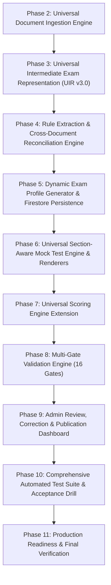

# Universal Document-Driven Mock Test Pipeline Implementation Plan

**Date:** 2026-11-14T02:50:00+05:30  
**Repository:** `C:\Users\RUPENDRA\Documents\VidyarthiAstra-current`  
**Target Architecture:** Document-Driven Pipeline Architecture Specification v3.0  
**Governing Standard:** Incremental, independently testable phases with zero regressions on existing suites.

---

## 1. Phased Execution Roadmap

The implementation is structured into 10 sequential, non-breaking engineering phases. Each phase concludes with automated test execution, verification against acceptance criteria, and git safety validation.

---

## 2. Phase-by-Phase Technical Specifications

---

### PHASE 2 — Universal Document Ingestion Engine

#### Goal:
Implement generalized, format-resilient document parsing for Question Papers, Answer Keys, and Format Documents without exam-specific regex heuristics.

#### Key Engineering Deliverables:
1. **`server/services/ingestion/universalDocumentParser.js`:**
   - Multi-format ingestion adapter: handles PDF buffers, DOCX streams (via XML text extraction), and image bundles.
   - Text item extractor with 2D coordinate preservation, spatial line assembly, and font-size tracking.
2. **`server/services/ingestion/questionPaperParser.js`:**
   - Section header detector: scans for structural markers (e.g. `Section`, `Part`, `Subject:`, `General Studies`, `Paper I`) using generalized spatial and linguistic cues.
   - Dynamic question boundary segmenter: identifies question starts (e.g. `Q. 1`, `1.`, `Question 14`) using sequence continuity rather than hardcoded ranges.
   - Option extractor: extracts monotonic sequences (`A..D`, `1..4`, `A..E`) and preserves sub-option statements.
   - Formula and table reassembler: converts fraction matrices and mathematical expressions into KaTeX-compatible strings.
3. **`server/services/ingestion/answerKeyParser.js`:**
   - Multi-format answer key reader: parses columnar tables, row tokens, and dense keys.
   - Decoupled mapper: maps question numbers to answers without assuming sequential identity.
   - Range-based key reader: parses numerical bounds (e.g. `[12.4, 12.6]`, `125 +/- 2`).
4. **`server/services/ingestion/paperFormatParser.js`:**
   - Instruction and syllabus parser: extracts duration, maximum marks, total questions, section count, positive/negative marks per section, and optional attempt instructions.
   - Provenance tagger: records source page, exact line snippet, and confidence score for every extracted rule.

#### Unit & Integration Tests:
- `tests/universal-document-ingestion.test.js`
  - Tests parsing of standard PDFs, multi-column layouts, and bilingual papers.
  - Tests parsing of dense, tabular, and multi-series answer keys.
  - Verifies that missing rules in format documents are tagged `UNKNOWN` rather than defaulted.

---

### PHASE 3 — Universal Intermediate Exam Representation (UIR v3.0)

#### Goal:
Implement a normalized, versioned in-memory data schema representing the complete exam structure before publication.

#### Key Engineering Deliverables:
1. **`server/services/schema/universalIntermediateRepresentation.js`:**
   - Formal JSON schema validator for UIR v3.0.
   - Canonical models for:
     - `ExamMetadata` (name, year, code, duration, total questions, max marks).
     - `SectionDefinition` (id, name, subject, startQ, endQ, requiredCount, markingScheme).
     - `QuestionItem` (id, number, sectionId, type, stem, options, diagrams, scoring overrides).
     - `AnswerKeyItem` (id, number, type, acceptedAnswers, numericRange, isDropped).
2. **Support for 9 Universal Question Types:**
   - `single_choice_mcq`
   - `multiple_choice_msq`
   - `numerical_nat`
   - `fill_in_the_blanks`
   - `match_following`
   - `assertion_reason`
   - `passage_comprehension`
   - `matrix_match`
   - `descriptive_manual`

#### Unit & Integration Tests:
- `tests/uir-schema-validation.test.js`
  - Validates correct schema construction across all 9 question types.
  - Rejects malformed question items, missing option IDs, and duplicate question keys.

---

### PHASE 4 — Rule Extraction & Cross-Document Reconciliation Engine

#### Goal:
Reconcile facts and rules extracted independently across the three documents to establish an authoritative consensus.

#### Key Engineering Deliverables:
1. **`server/services/reconciliation/ruleReconciliationEngine.js`:**
   - Fact comparator: cross-checks question paper counts against format document claims.
   - Discrepancy detector: flags mismatches (e.g. QP has 105 questions, format document declares 100).
   - Answer key series matcher: checks QP booklet code against AK booklet code.
   - Confidence scoring: calculates confidence for each parameter based on multi-document corroboration.
2. **Issue Categorization:**
   - `EXPLICIT_STATED`: Stated directly in format document.
   - `STRUCTURAL_DERIVED`: Derived by counting parsed elements.
   - `UNKNOWN`: Missing in all documents $\rightarrow$ **Mandatory Blocker**.
   - `CONFLICT`: Documents contradict each other $\rightarrow$ **Mandatory Blocker**.

#### Unit & Integration Tests:
- `tests/rule-reconciliation-engine.test.js`
  - Tests consensus resolution when all three documents agree.
  - Tests blocker generation when QP and Format documents disagree on total marks.
  - Tests detection of unknown negative marking rules.

---

### PHASE 5 — Dynamic Exam Profile Generator & Firestore Persistence

#### Goal:
Convert reconciled rules into an immutable, versioned `ExamProfile` stored as configuration data in Firestore.

#### Key Engineering Deliverables:
1. **`server/services/admin/profileGeneratorService.js`:**
   - Compiles validated UIR into an `ExamProfile` adhering to `ExamProfileRegistry` schema.
   - Generates deterministic `profileId` (e.g. `${examId}-${year}-v${version}`).
   - Sets provenance metadata with document hashes.
2. **`server/services/admin/examProfileRegistry.js` Dynamic Extension:**
   - Adds dynamic loader: checks in-memory cache, then queries Firestore `examProfiles/{profileId}` using project-bound `UniversalFirestoreClient`.
   - Caches validated profiles in memory.
   - Preserves all 10 existing hardcoded profiles for zero regression.

#### Unit & Integration Tests:
- `tests/dynamic-profile-generator.test.js`
  - Generates profile from synthetic exam UIR.
  - Validates schema against `ExamProfileRegistry.validateProfileSchema()`.
  - Verifies Firestore persistence and dynamic hydration.

---

### PHASE 6 — Universal Section-Aware Mock Test Engine & Renderers

#### Goal:
Upgrade the student-facing test interface to render dynamic sections and diverse question types.

#### Key Engineering Deliverables:
1. **`www/js/mock-test.js` Refactoring:**
   - **Section Tab Bar:** Dynamically renders tabs for each section in `test.sections`.
   - **Section Switching:** Handles section selection, active section filtering, and section instructions.
   - **Attempt Counter:** Tracks answered questions per section against `section.requiredCount`.
2. **Modular Question Renderers:**
   - `renderSingleChoiceMcq(q)`
   - `renderMultipleChoiceMsq(q)`
   - `renderNumericalNat(q)`
   - `renderAssertionReason(q)`
   - `renderMatchFollowing(q)`
   - `renderPassageComprehension(q)`
   - `renderDescriptive(q)`
3. **`www/mock-test.html` Layout Enhancement:**
   - Adds section navigation container `#sectionTabBar`.
   - Adds split-pane reading context container `#passageContextPane`.

#### Unit & Integration Tests:
- `tests/mock-test-section-navigation.test.js`
  - Verifies section switching, question palette filtering by section, and attempt counter updates.
  - Tests rendering of all 9 question types.

---

### PHASE 7 — Universal Scoring Engine Extension

#### Goal:
Extend `UniversalScoringEngine` to evaluate the new question types using exact rational arithmetic.

#### Key Engineering Deliverables:
1. **`server/services/scoring/universalScoringEngine.js` Extension:**
   - **MSQ Partial Marking:** Implements configurable partial credit via `Rational` fractions.
   - **Numerical Range Matching:** Evaluates numerical answers within `[min, max]` intervals.
   - **Matching & Fill-in-the-Blanks:** Evaluates multi-part answers.
   - **Descriptive Routing:** Sets `requiresManualEvaluation: true` and isolates descriptive marks from automated deduction.
2. **`server/services/mockTestScoringService.js` Generalization:**
   - Removes hardcoded exam conditionals (`isGateExam`, `isJeeExam`, etc.) from modern Schema v2 evaluation paths.
   - All modern tests route strictly through `UniversalScoringEngine` driven by the generated profile.
   - Preserves `LegacyScoringAdapter` for historical Schema v1 attempts.

#### Unit & Integration Tests:
- `tests/universal-scoring-extension.test.js`
  - Tests exact rational scoring of MSQs with partial marks.
  - Tests numerical range tolerances.
  - Verifies zero regression across all existing scoring tests (`universal-scoring-engine.test.js`).

---

### PHASE 8 — Multi-Gate Validation Engine

#### Goal:
Implement the 16 mandatory validation gates to prevent publishing incomplete or erroneous tests.

#### Key Engineering Deliverables:
1. **`server/services/admin/testValidationEngine.js`:**
   - Evaluates Gates 1 through 16:
     1. Source Document Completeness
     2. Question Count Parity
     3. Answer Key Coverage (100% of scored questions)
     4. Zero Duplicate Question IDs
     5. No Section Sequence Collisions
     6. No Missing Options for MCQs
     7. Monotonic Option Labels
     8. Scoring Rule Completeness
     9. Maximum Marks Mathematical Reconciliation
     10. Non-zero Duration Extraction
     11. Optional Question Policy Sanity
     12. Booklet Code / Series Parity
     13. Diagram Asset Integrity
     14. Descriptive Question Routing
     15. Content Fidelity (zero formula collisions or banner leaks)
     16. Cryptographic Validation Fingerprint Matching
2. **Validation Report Generation:**
   - Produces structured report: `canPublish: boolean`, `blockers: string[]`, `warnings: string[]`, `passedGates: string[]`.

#### Unit & Integration Tests:
- `tests/test-validation-engine.test.js`
  - Tests all 16 gates with positive and negative synthetic payloads.
  - Asserts that any critical blocker unconditionally forbids publication.

---

### PHASE 9 — Admin Review, Correction & Publication Dashboard

#### Goal:
Provide an intuitive administrative dashboard to inspect extracted rules, edit questions, resolve warnings, and approve publication.

#### Key Engineering Deliverables:
1. **Admin Review Endpoints (`server/routes/admin.js`):**
   - `GET /api/admin/import/jobs/:jobId/validation-report`: Returns the 16-gate validation breakdown.
   - `PUT /api/admin/import/jobs/:jobId/rules`: Allows admin to resolve unknown rules or supply manual overrides.
   - `PUT /api/admin/import/jobs/:jobId/questions/:qId`: Edits question stem, options, diagrams, or answer keys.
   - `POST /api/admin/import/jobs/:jobId/publish`: Publishes only if `canPublish === true` and zero blockers remain.
2. **Admin UI Updates (`www/js/admin.js` & `server/views/admin.html`):**
   - Renders 16-gate status cards (Green for Pass, Yellow for Warning, Red for Blocker).
   - Rule editor modal for duration, section marks, and optional question policies.
   - Question editor with formula preview and diagram inspector.

---

### PHASE 10 — Comprehensive Automated Testing & Acceptance Drill

#### Goal:
Execute an adversarial test suite proving that an entirely new, unprogrammed examination can be generated, attempted, and evaluated with zero code changes.

#### The Critical Acceptance Drill:
1. **Create Synthetic Exam:** "National Science Aptitude Test 2026" (NSAT 2026).
   - Exam does not exist anywhere in `ExamProfileRegistry` or the codebase.
   - Format: 3 sections (Section 1: 30 MCQs, +3 / -1; Section 2: 10 MSQs, +4 / 0; Section 3: 5 Numericals, +4 / 0, attempt any 3).
   - Duration: 150 minutes, Total marks: 152.
2. **Execute Ingestion & Pipeline:**
   - Provide synthetic QP, AK, and Format documents.
   - Pipeline extracts UIR, reconciles rules, passes validation gates, and generates `nsat-2026` profile.
3. **Execute Student Attempt & Evaluation:**
   - Student attempts test across all 3 sections.
   - Autosave and submission execute cleanly.
   - `UniversalScoringEngine` evaluates attempt using generated profile.
   - Results and analytics display with 100% mathematical precision.
4. **Pass Criterion:**
   - **Zero exam-specific code, conditionals, or manual configuration files written by developers.**
   - All 616 existing workspace tests continue to pass.

---

## 3. Strict Safety & Governance Constraints

1. **Local-First Development:** All implementation and testing must be performed locally using offline runners and local emulator instances.
2. **Zero Cloud Contamination:** No live GCP, Cloud Storage, or production Firestore operations.
3. **Production Migration NO-GO:** Production database migration remains **STRICT NO-GO**.
4. **Historical Attempt Preservation:** Zero modification or automated rescoring of existing student attempts.
5. **No Git Commit/Push:** Changes remain in working tree for inspection and review.

