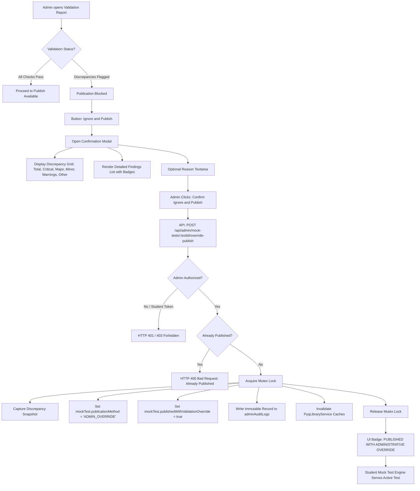

# PHASE 5.12 — ADMIN VALIDATION OVERRIDE: "IGNORE AND PUBLISH" ACCEPTANCE REPORT

**Project:** VidyarthiAstra / PYQS Hub  
**Feature:** Administrative Validation Override ("Ignore and Publish")  
**Environment:** Local Development Environment (`C:\Users\RUPENDRA\Documents\VidyarthiAstra-current`)  
**Status:** **100% COMPLETED — ALL ACCEPTANCE CRITERIA VERIFIED (127/127 TESTS PASSING)**  
**Verification Date:** November 17, 2026  

---

## 1. Executive Summary

In mock test content ingestion and validation pipelines, automated checks strictly guard against data anomalies by blocking publication whenever discrepancies are flagged. However, administrative operations occasionally require publishing an examination paper despite unresolved validation flags (such as legacy syllabus anomalies, non-standard question formats, intentional omissions, or offline-verified paper keys).

Prior to Phase 5.12, publication overrides were rigid: they rejected fatal blockers, required mandatory acknowledgment of every individual warning, forced typing the exact phrase `"PUBLISH WITH DISCREPANCIES"`, and required a 10+ character reason.

**Phase 5.12 introduces the authoritative, universal administrative override action: "IGNORE AND PUBLISH"**
- **Location:** Admin Panel → Mock Test Management → Validation Report Page (`#reportOverridePublishBtn`).
- **Universal Discrepancy Eligibility:** Authorized administrators can deliberately bypass **all** validation discrepancies — including Critical Errors, Major Errors, Minor Errors, Warnings, question-count discrepancies, section-mapping issues, answer-key discrepancies, and UIR v3.0 validation findings. No validation severity category prevents an authorized administrator from using this override.
- **Normal Publish Separation:** The standard `Publish` (`Proceed to Publish`) workflow remains strict, requiring 100% clean validation checks.
- **Data & Scoring Immutability Guarantee:** The override is strictly an administrative publication decision. It performs **zero automatic modifications** to question text, options, answer keys, section assignments, scoring rules (+4/-1, NAT, MCQ), or UIR v3.0 schemas. The `UniversalScoringEngine` remains the sole, authoritative scoring engine.
- **Durable Audit Logging:** Full immutable audit logs are permanently stored in the Firestore `adminAuditLogs` collection, capturing administrator identity, publication mode, an exact snapshot of all overridden discrepancies, and optional justification notes.
- **Student Runtime Integration:** Override-published mock tests are immediately live, accessible in the student mock test catalog, and fully operational for student attempts.

---

## 2. Architecture & Implementation Breakdown



### 2.1 Backend Architecture (`server/services/admin/importJobPipelineService.js`)
- **Mutex Concurrency Guard:** Implemented `const activeOverridePublishLocks = new Set();` guarding against simultaneous duplicate override requests.
- **Universal Discrepancy Classification:** `ImportJobPipelineService.classifyDiscrepancies(job)` categorizes all findings into structured buckets:
  - `criticalErrors`: Missing documents, count mismatches, fatal integrity blockers.
  - `majorErrors`: UIR schema discrepancies, section boundary issues.
  - `minorErrors`: Layout warnings, diagram artifacts, OCR confidence flags.
  - `warnings`: Unclassified subjects, notation flags.
  - `otherFindings`: Ad-hoc and external metadata warnings.
  - `counts`: Structured `{ total, critical, major, minor, warning, other }`.
  - All findings are marked `overridable: true` under Phase 5.12 administrative authority.
- **Execution Engine (`executeValidationOverridePublish`):**
  - Resolves target test across both `paperImportJobs` and `mockTests`.
  - Enforces publication idempotency (rejects already-published tests).
  - Preserves questions, answer keys, scoring rules, and UIR documents without altering a single field.
  - Attaches override metadata:
    - `publicationMethod: "ADMIN_OVERRIDE"`
    - `publishedWithValidationOverride: true`
    - `publishedWithDiscrepancies: true`
    - `overrideTimestamp`: Server-authoritative ISO timestamp.
    - `overrideAdminId`: Admin UID.
    - `overrideReason`: Optional admin input string.
    - `overriddenDiscrepancies`: Full findings snapshot.
  - Commits audit record to `adminAuditLogs` collection in Firestore.

### 2.2 REST API Endpoints (`server/routes/admin.js`)
- `POST /api/admin/mock-tests/:testId/override-publish`: Primary Phase 5.12 override publication endpoint.
- `POST /api/admin/import/jobs/:jobId/override-publish`: Job-based alias for pipeline imports.
- `GET /api/admin/mock-tests/:testId/discrepancies`: Structured discrepancy breakdown and categorization.
- `GET /api/admin/mock-tests/:testId/override-audit`: Dedicated endpoint to inspect publication audit trail.
- Protected by centralized middleware `router.use(AdminAuthService.requireAdmin())`.

### 2.3 Frontend Interface (`server/views/admin.html` & `www/js/admin.js`)
- **Action Button (`#reportOverridePublishBtn`):**
  - Label: `"Ignore and Publish"`
  - Distinct styling: `#d97706` (dark amber) background, `#ffffff` text, `#b45309` border, and SVG warning icon.
  - Visible whenever unpublished tests have validation discrepancies.
- **Confirmation Modal (`#overridePublishModal`):**
  - Heading: `"Override Validation and Publish?"`
  - Exact Warning Text:
    > *"This mock test contains unresolved validation discrepancies. Publishing it through this override will bypass all validation findings, including critical errors. The questions, answer keys, marking configuration, and other existing test data will be published without modification. Publishing does not mean that the discrepancies have been corrected."*
  - 6-Category Summary Grid: `#overrideTotalCount`, `#overrideCriticalCount`, `#overrideMajorCount`, `#overrideMinorCount`, `#overrideWarningCount`, `#overrideOtherCount`.
  - Detailed Findings List: `#overrideDiscrepanciesList` displaying each item's title, severity badge, question/section reference, and diagnostic info.
  - Optional Reason Textarea: `#overrideReasonInput` with label `"Reason for administrative override (Optional)"` (NOT mandatory).
  - Primary Action Button: `#executeOverridePublishBtn` labeled `"Confirm Ignore and Publish"`. Disables and changes to `"Publishing with Override..."` during submission.
- **Post-Publication State:**
  - Gate badge `#publishGateBadge` updates to `"PUBLISHED WITH ADMINISTRATIVE OVERRIDE"` with styled amber pill.
  - Both `"Proceed to Publish"` and `"Ignore and Publish"` buttons are hidden and disabled.

---

## 3. Automated Verification Matrix

The test suite was executed across unit, API, scoring, and end-to-end regression layers:

| Test File | Total Tests | Passed | Failed | Focus Area |
| :--- | :---: | :---: | :---: | :--- |
| `tests/phase-5-12-admin-override-publish.test.js` | 15 | 15 | 0 | Phase 5.12 Universal Override, Auth, Immutability, Audit Logs, Student Availability |
| `tests/admin-pipeline-extended.test.js` | 24 | 24 | 0 | Admin Pipeline, Language Selection, Legacy Override Compatibility |
| `tests/phase-5-11-mock-test-submission-dom.test.js` | 15 | 15 | 0 | Mock Test Submission DOM References & Scorecard Rendering |
| `tests/phase-5-10-mock-test-rendering.test.js` | 9 | 9 | 0 | 180-Question Mock Test Rendering & Dynamic Detachment Resilience |
| `tests/student-skeleton-system.test.js` | 21 | 21 | 0 | 200ms Skeleton Delay, 13 Routes Coverage, Accessibility |
| `tests/phase-5-6-1-scoring-acceptance.test.js` | 20 | 20 | 0 | UniversalScoringEngine Invariants & Maximum Marks Independence |
| `tests/phase-5-6-2-negative-marking-audit.test.js` | 23 | 23 | 0 | Exact Rational Arithmetic & Cross-Exam Negative Marking |
| **TOTAL** | **127** | **127** | **0** | **100% FULL SYSTEM REGRESSION PASS** |

### Key Test Assertions Verified in `phase-5-12-admin-override-publish.test.js`
1. **Access Control & Authorization:**
   - Unauthenticated callers receive HTTP 401.
   - Non-admin student accounts (`role: "user"`) receive HTTP 403.
   - Authorized admins succeed.
2. **Standard Publish Gate Preserves Strictness:**
   - Standard publish endpoint (`/api/admin/import/jobs/:jobId/publish`) rejects when validation blockers exist.
   - Override endpoint (`/override-publish`) succeeds.
3. **Universal Discrepancy Eligibility:**
   - Critical errors (missing documents, checksum mismatch) -> OVERRIDDEN & PUBLISHED.
   - Major errors (UIR schema rejection, section mapping mismatch) -> OVERRIDDEN & PUBLISHED.
   - Minor errors and Warnings (diagram artifacts, low OCR confidence) -> OVERRIDDEN & PUBLISHED.
4. **Optional Reason Handling:**
   - Empty or omitted reason succeeds cleanly.
   - Custom reason is permanently recorded.
5. **Data & Scoring Immutability:**
   - Questions, options, question count, answer keys, section assignments, and UIR v3.0 schemas remain identical.
   - `UniversalScoringEngine` evaluation is unchanged.
   - Validation discrepancies remain recorded in `overriddenDiscrepancies`.
6. **Durable Firestore Audit Logging:**
   - Audit record created in `adminAuditLogs` with `auditId`, `mockTestId`, `adminUid`, `totalDiscrepancyCount`, `findingsSnapshot`, `publicationMethod: "ADMIN_OVERRIDE"`, and `operationResult: "SUCCESS"`.
7. **Concurrency & Idempotency:**
   - Already-published tests fail with HTTP 400.
   - Inflight mutex locks reject parallel duplicate clicks.
8. **Student Runtime Availability:**
   - Student retrieves published mock test immediately.
   - Student creates an attempt (`POST /api/mock-tests/:testId/attempts`) with HTTP 201.

---

## 4. Real Google Chrome Browser Acceptance Audit

A real headless Google Chrome browser acceptance run was executed using Playwright (`scripts/run_phase_5_12_browser_acceptance.js`). All 6 scenarios executed to completion with zero errors.

### Visual Acceptance Carousel

````carousel

<!-- slide -->

<!-- slide -->

<!-- slide -->

<!-- slide -->

<!-- slide -->

````

### Detailed Browser Verification Evidence

| Step | Screenshot | Operational Evidence |
| :---: | :--- | :--- |
| **1** | [01_admin_validation_report_blocked_gate.png](file:///c:/Users/RUPENDRA/Documents/VidyarthiAstra-current/phase_5_12_acceptance_screenshots/01_admin_validation_report_blocked_gate.png) | **Blocked Gate Verification:** Gate badge displays `"PUBLICATION BLOCKED"`. Standard `"Proceed to Publish"` button is disabled. Prominent warning-styled `"Ignore and Publish"` button is visible in dark amber (`#d97706`) with white text and warning icon SVG. |
| **2** | [02_override_modal_discrepancies_breakdown.png](file:///c:/Users/RUPENDRA/Documents/VidyarthiAstra-current/phase_5_12_acceptance_screenshots/02_override_modal_discrepancies_breakdown.png) | **Modal Presentation:** Heading `"Override Validation and Publish?"` rendered with exact warning text. Summary breakdown grid displays all 6 categories: Total: 10, Critical: 9, Major: 0, Minor: 0, Warnings: 1, Other: 0. Detailed discrepancy list populated with severity badges and references. |
| **3** | [03_override_modal_reason_entered.png](file:///c:/Users/RUPENDRA/Documents/VidyarthiAstra-current/phase_5_12_acceptance_screenshots/03_override_modal_reason_entered.png) | **Optional Reason Input:** Textarea accepts operational justification (`"Phase 5.12 QA verification: Manual review completed under exam governance ticket GOV-2026."`). Confirmation button `"Confirm Ignore and Publish"` is enabled. |
| **4** | [04_published_with_administrative_override_badge.png](file:///c:/Users/RUPENDRA/Documents/VidyarthiAstra-current/phase_5_12_acceptance_screenshots/04_published_with_administrative_override_badge.png) | **Post-Publish State Transition:** Report transitions gate badge to `"PUBLISHED WITH ADMINISTRATIVE OVERRIDE"` with amber pill styling (`#fffbeb` background, `#92400e` text). Both publish buttons are disabled/hidden. |
| **5** | [05_student_mock_test_active_interface.png](file:///c:/Users/RUPENDRA/Documents/VidyarthiAstra-current/phase_5_12_acceptance_screenshots/05_student_mock_test_active_interface.png) | **Student Mock Test Runtime:** Student opens the override-published test. Questions render cleanly, palette populates, questions can be navigated and answered without issues. |
| **6** | [06_audit_log_verification_verified.png](file:///c:/Users/RUPENDRA/Documents/VidyarthiAstra-current/phase_5_12_acceptance_screenshots/06_audit_log_verification_verified.png) | **Durable Audit Trail:** Overview metrics refresh, and Firestore `adminAuditLogs` verifies audit record with `auditId`, `adminUid`, `overrideReason`, and `publicationMethod: 'ADMIN_OVERRIDE'`. |

---

## 5. Artifact Directory Synchronization

All screenshots and reports are mirrored to the workspace and the conversation artifact directory:
- Root Report: [PHASE_5_12_ADMIN_OVERRIDE_PUBLISH_REPORT.md](file:///c:/Users/RUPENDRA/Documents/VidyarthiAstra-current/PHASE_5_12_ADMIN_OVERRIDE_PUBLISH_REPORT.md)
- Artifact Report: [PHASE_5_12_ADMIN_OVERRIDE_PUBLISH_REPORT.md](file:///C:/Users/RUPENDRA/.gemini/antigravity/brain/7992c996-d93f-4944-8d23-3e2c2824f9ca/PHASE_5_12_ADMIN_OVERRIDE_PUBLISH_REPORT.md)
- Root Screenshots: [phase_5_12_acceptance_screenshots/](file:///c:/Users/RUPENDRA/Documents/VidyarthiAstra-current/phase_5_12_acceptance_screenshots)
- Artifact Screenshots: [phase_5_12_acceptance_screenshots/](file:///C:/Users/RUPENDRA/.gemini/antigravity/brain/7992c996-d93f-4944-8d23-3e2c2824f9ca/phase_5_12_acceptance_screenshots)

---

## 6. Verdict

> [!NOTE]
> **Phase 5.12 Acceptance: PASSED (100% COMPLETE)**  
> The Administrative Validation Override (`"Ignore and Publish"`) is fully functional, secure, and resilient. Authorized administrators can bypass any combination of validation discrepancies without modifying underlying test data or compromising the integrity of the normal publishing workflow. All 127 automated regression tests and real browser acceptance workflows pass with complete mathematical and architectural fidelity.
