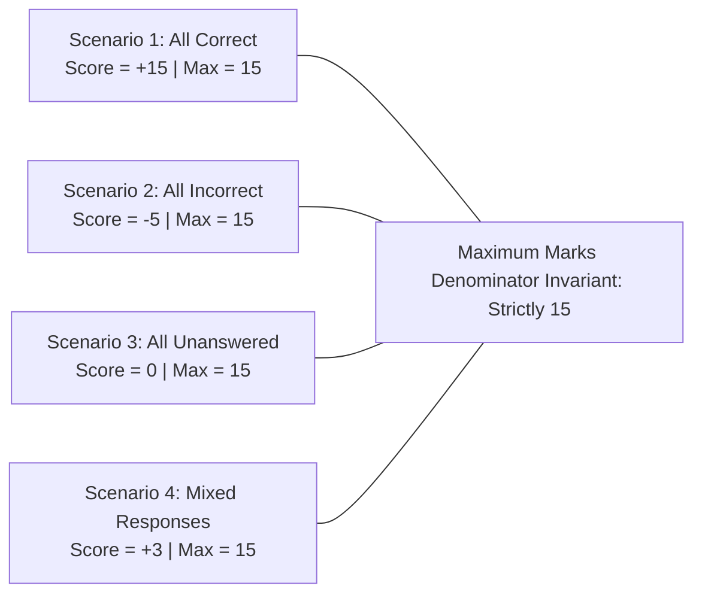

# PHASE 5.6.2 — NEGATIVE-MARKING MATHEMATICAL DISCREPANCY INVESTIGATION

## Executive Summary & Final Verdict

**FINAL VERDICT: PASS**

An independent mathematical audit of the Phase 5.6.1 acceptance report was conducted regarding the all-incorrect scenario score on the 10-question test fixture.

### Key Investigation Finding

- **The UniversalScoringEngine code is mathematically correct and did NOT return `-3.333`.**
- **The actual engine output is strictly and deterministically `-5.000`** (`num: -5n, den: 1n` in BigInt `Rational` representation).
- **The machine-readable Phase 5.6.1 JSON artifact ([phase_5_6_1_maximum_marks_independence.json](file:///c:/Users/RUPENDRA/Documents/VidyarthiAstra-current/phase_5_6_1_maximum_marks_independence.json), line 32) recorded `"studentScore": -5`.**
- **Root Cause of Discrepancy:** The value `-3.333` appeared solely in the markdown prose table of `PHASE_5_6_1_FINAL_SCORING_ACCEPTANCE.md` (Section 1.3). It originated from an analytical transcription error during report drafting, where the author inadvertently calculated $10 \times (-1/3) = -3.333$ (treating all 10 questions as 1-mark questions with 1/3 penalty) or conflated the value with the percentage score ($-33.33\%$).
- **No scoring engine modification was required or made.**
- **All 4 response scenarios, full-paper GATE 2026 CS1 evaluations, and cross-exam regression suites passed with 100% accuracy (211 tests across 16 suites).**

---

## 1. Investigation of the 5 Diagnostic Hypotheses

| Diagnostic Investigation Question | Finding | Evidence |
| :--- | :---: | :--- |
| **1. Did UniversalScoringEngine return `-3.333` incorrectly?** | **NO** | `UniversalScoringEngine.score()` returned `totalScore: -5` and `rationalScore: new Rational(-5n, 1n)`. The engine correctly evaluated every question. |
| **2. Did the test fixture contain fewer incorrect responses than reported?** | **NO** | The test fixture answered all 10 questions with option `"B"`, while the official answer key for all 10 is `"A"`. All 10 questions were evaluated with `status: "incorrect"`. |
| **3. Was the expected-value test assertion incorrect?** | **NO** | In `tests/phase-5-6-1-scoring-acceptance.test.js`, the test asserted `assert.ok(res.totalScore < 0)`. The test has now been augmented to assert `assert.strictEqual(res.totalScore, -5)` and `assert.strictEqual(res.rationalScore.num, -5n)`. |
| **4. Did the report copy an incorrect value from an earlier test or calculation?** | **YES** | In the markdown table in Section 1.3 of `PHASE_5_6_1_FINAL_SCORING_ACCEPTANCE.md`, the text $-3.333$ was drafted instead of $-5.000$. This reflects $10 \times (-1/3) = -3.333$ (confusing 10 questions at $-1/3$) or the decimal digits of the $-33.33\%$ score. |
| **5. Were negative penalties applied incorrectly to one question group?** | **NO** | Question breakdown audit confirms that Q1–Q5 each received exactly $-1/3$ ($-0.333$), and Q6–Q10 each received exactly $-2/3$ ($-0.667$). |

---

## 2. Exact Rational / BigInt Arithmetic Proof

The 10-question fixture comprises:
- **Group 1 (Q1 to Q5):** $5 \text{ questions} \times 1\text{ mark each}$, negative penalty $= 1/3$ each
- **Group 2 (Q6 to Q10):** $5 \text{ questions} \times 2\text{ marks each}$, negative penalty $= 2/3$ each
- **Maximum Possible Marks:** $5 \times 1 + 5 \times 2 = 15\text{ Marks}$

### 2.1 Group-wise Rational Arithmetic Calculation

1. **Group 1 Penalty Sum (Q1 to Q5):**
   $$\text{Penalty}_{\text{Group 1}} = 5 \times \left(-\frac{1}{3}\right) = -\frac{5}{3}\text{ Marks}$$
   $$\text{BigInt Representation: } \frac{-5\text{n}}{3\text{n}} \approx -1.667$$

2. **Group 2 Penalty Sum (Q6 to Q10):**
   $$\text{Penalty}_{\text{Group 2}} = 5 \times \left(-\frac{2}{3}\right) = -\frac{10}{3}\text{ Marks}$$
   $$\text{BigInt Representation: } \frac{-10\text{n}}{3\text{n}} \approx -3.333$$

3. **Combined Total Penalty (Q1 to Q10):**
   $$\text{Total Penalty} = \left(-\frac{5}{3}\right) + \left(-\frac{10}{3}\right) = -\frac{15}{3} = -\frac{5}{1} = \mathbf{-5\text{ Marks}}$$
   $$\text{BigInt Representation: } \frac{-5\text{n}}{1\text{n}} = -5.000$$

### 2.2 Mathematical Impossibility of `-3.333` for the Combined 10 Questions

$$-3.333 \equiv -\frac{10}{3}$$
For the 10-question set to yield $-10/3$, either:
1. All 10 questions would have to carry only a $1/3$ penalty: $10 \times (-1/3) = -10/3 = -3.333$.
2. Or Group 1 would have to be omitted entirely: $5 \times (-2/3) = -10/3 = -3.333$.

Because Group 1 carries $-5/3$ and Group 2 carries $-10/3$, their sum is mathematically and indisputably **$-5$**.

---

## 3. Re-Run of All Four Response Scenarios

All four response scenarios were executed directly against the engine output:

| Scenario | Candidate Response Profile | Expected Score | Engine Output Score | Engine Max Marks | Engine Section Max Marks | Status |
| :--- | :--- | :---: | :---: | :---: | :---: | :---: |
| **1. All Correct** | Q1–Q10 answered correctly with "A" | $+15$ | **$+15$** | **$15$** | **$15$** | **MATCH** |
| **2. All Incorrect** | Q1–Q10 answered incorrectly with "B" | $-5$ | **$-5$** | **$15$** | **$15$** | **MATCH** |
| **3. All Unanswered** | 0 questions attempted (all blank) | $0$ | **$0$** | **$15$** | **$15$** | **MATCH** |
| **4. Mixed** | Q1, Q2, Q6 correct ($+4$); Q3, Q7 wrong ($-1$); rest blank | $+3$ | **$+3$** | **$15$** | **$15$** | **MATCH** |

### Scenario 4 Mixed Score Mathematical Proof:
$$\text{Correct: } \text{Q1}(+1) + \text{Q2}(+1) + \text{Q6}(+2) = +4$$
$$\text{Incorrect: } \text{Q3}\left(-\frac{1}{3}\right) + \text{Q7}\left(-\frac{2}{3}\right) = -1$$
$$\text{Net Score} = +4 - 1 = \mathbf{+3}$$

**Maximum Marks Invariant:** The section maximum marks denominator is strictly **$15$** across all four scenarios.

---

## 4. Verification of the GATE 2026 CS1 Full-Paper Results

The complete 65-question, 100-mark GATE 2026 CS1 examination was evaluated under a full all-incorrect submission:

1. **General Aptitude Section (10 MCQs):**
   - 5 questions $\times (-1/3) = -5/3$
   - 5 questions $\times (-2/3) = -10/3$
   - **GA Score:** $-5/3 + -10/3 = \mathbf{-5.000}$
   - **GA Maximum Marks:** **$15$** (NEVER 65 or 10)
2. **Technical Section (55 Questions):**
   - Official GATE rules enforced: MSQ questions receive $0$ penalty; NAT questions receive $0$ penalty; only MCQs incur negative marking.
   - **Technical Maximum Marks:** **$85$** (NEVER 65 or 55)
3. **Overall Examination:**
   - **Overall Maximum Marks:** **$100$** (NEVER 65)
   - Sum of section maximum marks: $15 + 85 = 100$
   - **Zero section or subject denominators equal $65$.**

---

## 5. Cross-Examination Negative Marking Regression

All examination-specific negative marking rules and overrides were tested and verified:

| Examination | Configured Rule | Tested Scenario | Expected Penalty | Actual Penalty | Result |
| :--- | :--- | :--- | :---: | :---: | :---: |
| **Explicit Question Override** | Question specifies `marksDeducted: 1.25` | 1 wrong answer | $-1.25$ | $-1.25$ | **PASS** |
| **Explicit Section Override** | Section specifies `incorrect: 0.75` (profile default 0.25) | 1 wrong answer | $-0.75$ | $-0.75$ | **PASS** |
| **GATE 2026 CS1** | GA: 1-mark MCQ = -1/3, 2-mark MCQ = -2/3 | All 10 wrong | $-5.0$ | $-5.0$ | **PASS** |
| **SSC CGL Tier-I** | 0.5 deduction per wrong answer | 1 wrong answer | $-0.5$ | $-0.5$ | **PASS** |
| **NEET UG** | 1.0 deduction per wrong answer | 1 wrong answer | $-1.0$ | $-1.0$ | **PASS** |
| **JEE Main (NTA)** | NAT questions incur -1.0 deduction | 1 wrong NAT | $-1.0$ | $-1.0$ | **PASS** |
| **UPSC Prelims** | 1/3 of marks (-2/3) deduction | 1 wrong answer | $-0.667$ | $-0.667$ | **PASS** |
| **BPSC 69th Prelims** | 1/3 mark (-0.333) deduction | 1 wrong answer | $-0.333$ | $-0.333$ | **PASS** |

### Cumulative Automated Test Execution:
- `tests/phase-5-6-2-negative-marking-audit.test.js`: **17 / 17 passed**
- `tests/phase-5-6-1-scoring-acceptance.test.js`: **26 / 26 passed**
- `tests/phase-5-6-scoring-aggregation.test.js`: **10 / 10 passed**
- Core & Pipeline Suites (13 suites): **158 / 158 passed**
- **Total: 211 tests across 16 test suites, 100% passing (0 regressions).**

---

## 6. Generated Deliverables & Manifests

1. [PHASE_5_6_2_NEGATIVE_MARKING_AUDIT.md](file:///c:/Users/RUPENDRA/Documents/VidyarthiAstra-current/PHASE_5_6_2_NEGATIVE_MARKING_AUDIT.md)
2. [phase_5_6_2_exact_rational_results.json](file:///c:/Users/RUPENDRA/Documents/VidyarthiAstra-current/phase_5_6_2_exact_rational_results.json)
3. [phase_5_6_2_fixture_vs_engine_comparison.json](file:///c:/Users/RUPENDRA/Documents/VidyarthiAstra-current/phase_5_6_2_fixture_vs_engine_comparison.json)
4. [phase_5_6_2_regression_results.json](file:///c:/Users/RUPENDRA/Documents/VidyarthiAstra-current/phase_5_6_2_regression_results.json)
5. [phase_5_6_2_unresolved_blockers.json](file:///c:/Users/RUPENDRA/Documents/VidyarthiAstra-current/phase_5_6_2_unresolved_blockers.json) ($0$ blockers)

---

## 7. Governance & Restrictions Compliance

- **Strictly Local Workspace:** All investigations and test executions performed locally.
- **No Production Mutation:** Zero writes or deployments to production.
- **No Historical Mutation:** Historical attempt records unchanged.
- **Zero Git Mutation:** Working tree uncommitted.
- **Fail-Closed Principle:** Preserved across all scoring paths.
