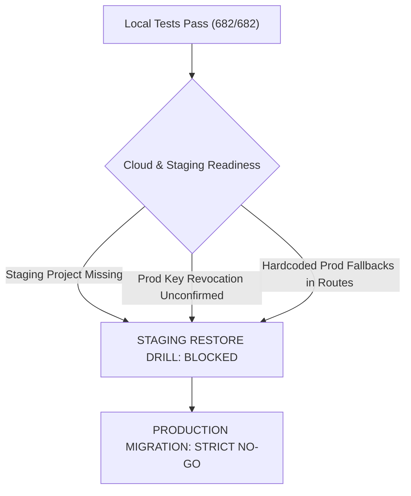

# Milestone 3 — Staging Restore Readiness Report

**Audit Date:** 2026-11-14T01:15:00+05:30  
**Repository:** `C:\Users\RUPENDRA\Documents\VidyarthiAstra-current`  
**Git Working Tree:** Commit `0797cd3` (`main`) with uncommitted Milestone 1-3 changes  
**Target Architecture:** Node.js, Express, Firebase Auth, Google Cloud Firestore, Hostinger Managed Hosting  
**Overall Readiness Verdict:** **NOT READY FOR LIVE STAGING RESTORE**  
**Production Migration Decision:** **STRICT NO-GO**

---

## 1. Executive Summary

This audit assesses the technical, security, and operational readiness of the VidyarthiAstra repository to perform a live staging restore drill of Google Cloud Firestore data.

While local emulator tests, bounded-batch committing, rational scoring arithmetic, and administrative deletion isolation have achieved 100% test pass rates in offline test environments, the project is **NOT READY** for live cloud staging restore execution. 

Five critical blockers prevent live staging restore execution:
1. **Unconfirmed Production Credential Revocation:** A production service account credential (`serviceAccountKey.json`) remains present in the local workspace directory; whether it has been revoked or rotated in Google Cloud IAM cannot be established from repository evidence.
2. **Missing Staging Project and Dedicated Credentials:** No isolated staging GCP/Firebase project is configured, nor do dedicated staging service account credentials exist in the workspace or repository.
3. **Hardcoded Production Fallbacks in Application Routes:** Multiple production routes and core services (`papers.js`, `studyResources.js`, `pyqLibraryService.js`, `questionExtractionService.js`, `paperSearchService.js`, `adminAuthService.js`, and `admin.js`) contain hardcoded defaults to production project `pyqs-hub-43bed` if `FIREBASE_PROJECT_ID` is omitted.
4. **Ambient Fallback in Historical Migration Service:** `HistoricalAttemptMigrationService` (`discoverInventory`, `executeDryRun`, `executeBatchMigration`) falls back to ambient `process.env.FIREBASE_PROJECT_ID` if explicit `client` or `targetProjectId` is not passed.
5. **Unverified Cloud Infrastructure:** Production backup bucket `gs://pyqs-hub-43bed-backups-asia-south1`, GCS IAM bindings, and cross-project Firestore service agent permissions have not been provisioned or verified in GCP.

---

## 2. Mandatory Safety Boundary & Audit Restrictions

In strict accordance with the audit protocol:
- **Zero Cloud Operations Executed:** No requests were made to Google Cloud Platform, production Firestore, staging Firestore, or Google Cloud Storage.
- **Zero Destructive Scripts Run:** Neither `reset-staging-baseline.js`, `preflight-backup-check.sh`, `preflight-staging-import-check.sh`, nor live migration scripts were executed against any cloud environment.
- **Zero Credential Modifications:** No IAM roles, service accounts, or secret keys were modified or generated.
- **No Secret Exposure:** Private keys and credential contents were never logged or extracted.
- **Strict Read-Only Local Scope:** Only local static code analysis and offline emulator test suites were executed.

---

## 3. Exact Files Inspected

### Administrative & Core Services
- [server/services/admin/universalFirestoreService.js](file:///C:/Users/RUPENDRA/Documents/VidyarthiAstra-current/server/services/admin/universalFirestoreService.js)
- [server/services/admin/historicalAttemptMigrationService.js](file:///C:/Users/RUPENDRA/Documents/VidyarthiAstra-current/server/services/admin/historicalAttemptMigrationService.js)
- [server/services/admin/postBackupReconciliationService.js](file:///C:/Users/RUPENDRA/Documents/VidyarthiAstra-current/server/services/admin/postBackupReconciliationService.js)
- [server/services/admin/adminAuthService.js](file:///C:/Users/RUPENDRA/Documents/VidyarthiAstra-current/server/services/admin/adminAuthService.js)
- [server/services/admin/adminUserService.js](file:///C:/Users/RUPENDRA/Documents/VidyarthiAstra-current/server/services/admin/adminUserService.js)
- [server/services/admin/examProfileRegistry.js](file:///C:/Users/RUPENDRA/Documents/VidyarthiAstra-current/server/services/admin/examProfileRegistry.js)
- [server/services/admin/storageVaultService.js](file:///C:/Users/RUPENDRA/Documents/VidyarthiAstra-current/server/services/admin/storageVaultService.js)
- [server/services/firebaseTokenService.js](file:///C:/Users/RUPENDRA/Documents/VidyarthiAstra-current/server/services/firebaseTokenService.js)
- [server/services/mockTestDeletionService.js](file:///C:/Users/RUPENDRA/Documents/VidyarthiAstra-current/server/services/mockTestDeletionService.js)
- [server/services/mockTestService.js](file:///C:/Users/RUPENDRA/Documents/VidyarthiAstra-current/server/services/mockTestService.js)

### Application Routes & Secondary Services
- [server/routes/admin.js](file:///C:/Users/RUPENDRA/Documents/VidyarthiAstra-current/server/routes/admin.js)
- [server/routes/papers.js](file:///C:/Users/RUPENDRA/Documents/VidyarthiAstra-current/server/routes/papers.js)
- [server/routes/studyResources.js](file:///C:/Users/RUPENDRA/Documents/VidyarthiAstra-current/server/routes/studyResources.js)
- [server/services/pyqLibraryService.js](file:///C:/Users/RUPENDRA/Documents/VidyarthiAstra-current/server/services/pyqLibraryService.js)
- [server/services/questionExtractionService.js](file:///C:/Users/RUPENDRA/Documents/VidyarthiAstra-current/server/services/questionExtractionService.js)
- [server/services/paperSearchService.js](file:///C:/Users/RUPENDRA/Documents/VidyarthiAstra-current/server/services/paperSearchService.js)

### Scoring Architecture
- [server/services/scoring/universalScoringEngine.js](file:///C:/Users/RUPENDRA/Documents/VidyarthiAstra-current/server/services/scoring/universalScoringEngine.js)
- [server/services/scoring/rational.js](file:///C:/Users/RUPENDRA/Documents/VidyarthiAstra-current/server/services/scoring/rational.js)
- [server/services/scoring/legacyScoringAdapter.js](file:///C:/Users/RUPENDRA/Documents/VidyarthiAstra-current/server/services/scoring/legacyScoringAdapter.js)

### Operational Scripts
- [scripts/preflight-backup-check.sh](file:///C:/Users/RUPENDRA/Documents/VidyarthiAstra-current/scripts/preflight-backup-check.sh)
- [scripts/preflight-staging-import-check.sh](file:///C:/Users/RUPENDRA/Documents/VidyarthiAstra-current/scripts/preflight-staging-import-check.sh)
- [scripts/reset-staging-baseline.js](file:///C:/Users/RUPENDRA/Documents/VidyarthiAstra-current/scripts/reset-staging-baseline.js)
- [scripts/export-pre-migration-snapshot.js](file:///C:/Users/RUPENDRA/Documents/VidyarthiAstra-current/scripts/export-pre-migration-snapshot.js)
- [scripts/generate-pre-export-counts.js](file:///C:/Users/RUPENDRA/Documents/VidyarthiAstra-current/scripts/generate-pre-export-counts.js)
- [scripts/reconcile-post-backup.js](file:///C:/Users/RUPENDRA/Documents/VidyarthiAstra-current/scripts/reconcile-post-backup.js)
- [scripts/migrate-historical-attempts.js](file:///C:/Users/RUPENDRA/Documents/VidyarthiAstra-current/scripts/migrate-historical-attempts.js)

### Configuration & Deployment Ignores
- [.firebaserc](file:///C:/Users/RUPENDRA/Documents/VidyarthiAstra-current/.firebaserc)
- [.gitignore](file:///C:/Users/RUPENDRA/Documents/VidyarthiAstra-current/.gitignore)
- [.firebaseignore](file:///C:/Users/RUPENDRA/Documents/VidyarthiAstra-current/.firebaseignore)
- [.gcloudignore](file:///C:/Users/RUPENDRA/Documents/VidyarthiAstra-current/.gcloudignore)
- [.env.example](file:///C:/Users/RUPENDRA/Documents/VidyarthiAstra-current/.env.example)

### Emulator & Verification Test Suites
- [tests/test-auth-isolation.test.js](file:///C:/Users/RUPENDRA/Documents/VidyarthiAstra-current/tests/test-auth-isolation.test.js)
- [tests/cascade-deletion-emulator.test.js](file:///C:/Users/RUPENDRA/Documents/VidyarthiAstra-current/tests/cascade-deletion-emulator.test.js)
- [tests/deletion-resilience-emulator.test.js](file:///C:/Users/RUPENDRA/Documents/VidyarthiAstra-current/tests/deletion-resilience-emulator.test.js)
- [tests/firestore-emulator-recovery.test.js](file:///C:/Users/RUPENDRA/Documents/VidyarthiAstra-current/tests/firestore-emulator-recovery.test.js)
- [tests/firestore-rules-emulator.test.js](file:///C:/Users/RUPENDRA/Documents/VidyarthiAstra-current/tests/firestore-rules-emulator.test.js)

---

## 4. Audit A — Staging Environment Readiness

### Verified Implementation Strengths
1. **Explicit Project Identity in Administrative Utilities:** `reset-staging-baseline.js`, `export-pre-migration-snapshot.js`, and `reconcile-post-backup.js` require explicit `--project=<id>` CLI parameters and reject ambient execution.
2. **Hard Production ID & Number Blocks:** `reset-staging-baseline.js` (Gate 2) and `reconcile-post-backup.js` unconditionally abort if the target project matches `pyqs-hub-43bed`, project number `766070215379`, or contains the substrings `prod` or `pyqs-hub`.
3. **Allowlisted Staging Targets:** `ALLOWED_STAGING_PROJECTS` in `postBackupReconciliationService.js` strictly limits permitted execution to `demo-vidyarthiastra`, `staging-vidyarthiastra`, and `staging-pyqs-hub`.
4. **Project ID vs Numeric Project Number Distinction:** `validateProjectIdFormat` enforces strict GCP lowercase naming rules (`/^[a-z][a-z0-9-]{2,28}[a-z0-9]$/`) and explicitly rejects numeric project numbers, while `validateProjectNumberFormat` enforces 6 to 16 numeric digits.

### Critical Vulnerabilities & Unsafe Fallbacks
1. **No Staging Project Defined in Configuration:** `.firebaserc` contains only `"default": "pyqs-hub-43bed"`. There is no staging alias or staging configuration.
2. **Hardcoded Fallbacks to Production Across Core Routes:**
   - `server/routes/papers.js:7`: `const FIREBASE_PROJECT_ID = process.env.FIREBASE_PROJECT_ID || "pyqs-hub-43bed";`
   - `server/routes/studyResources.js:10`: `const FIREBASE_PROJECT_ID = process.env.FIREBASE_PROJECT_ID || "pyqs-hub-43bed";`
   - `server/services/pyqLibraryService.js:7`: `const FIREBASE_PROJECT_ID = process.env.FIREBASE_PROJECT_ID || "pyqs-hub-43bed";`
   - `server/services/questionExtractionService.js:12`: `const FIREBASE_PROJECT_ID = process.env.FIREBASE_PROJECT_ID || "pyqs-hub-43bed";`
   - `server/services/paperSearchService.js:12`: `const FIREBASE_PROJECT_ID = process.env.FIREBASE_PROJECT_ID || "pyqs-hub-43bed";`
   - `server/services/admin/adminAuthService.js:91`: `const targetProjectId = process.env.FIREBASE_PROJECT_ID || UniversalFirestoreService.projectId || "pyqs-hub-43bed";`
   - `server/routes/admin.js:55`: `targetProjectId: process.env.FIREBASE_PROJECT_ID || UniversalFirestoreService.projectId || "pyqs-hub-43bed",`
   - **Risk:** If a staging instance is launched without setting `FIREBASE_PROJECT_ID`, all of these services immediately target production Firestore.
3. **Static Administrative Calls Without Project Binding:**
   - In `server/routes/admin.js`, routes `/users` (line 66), `/questions/:questionId` (lines 494, 519), and `/import/jobs/:jobId/mock-tests` (line 807) invoke static `UniversalFirestoreService.listDocuments()` or `getDocument()` without passing `req.adminClient` or `{ projectId: req.targetProjectId }`.
4. **Ambient Fallback in `HistoricalAttemptMigrationService`:**
   - Lines 474-476, 597-599, and 719-721 fall back to `process.env.FIREBASE_PROJECT_ID` if neither `client` nor `targetProjectId` is provided. If `FIREBASE_PROJECT_ID` happens to be production, unparameterized batch migration could target production.

---

## 5. Audit B — Credential & IAM Readiness

### Verified Implementation Strengths
1. **Local Automatic Key Loading Removed:** `loadServiceAccountKey()` in `server/services/firebaseTokenService.js` no longer automatically loads `./serviceAccountKey.json` from the repository root. Credentials must be explicitly supplied via `FIREBASE_SERVICE_ACCOUNT` or `GOOGLE_APPLICATION_CREDENTIALS`.
2. **Cross-Environment Credential Guard:** `validateServiceAccountCredentials` strictly prevents cross-project credential leakage:
   - A production credential (`client_email` matching `pyqs-hub-43bed` or `766070215379`) cannot be used when targeting non-production.
   - A staging credential cannot be used when targeting production.
   - Any mismatch between `sa.project_id` and `expectedProjectId` throws a fatal safety error.
3. **Sanitized Diagnostics & Reports:** `getFirebaseConfigDiagnostics` and audit logs record only `serviceAccountEmail` and `serviceAccountProjectId`; private keys are never logged.
4. **Deployment Exclusion:** `.gitignore`, `.firebaseignore`, and `.gcloudignore` all explicitly exclude `serviceAccountKey*.json` and `.env*`.
5. **Git History Cleanliness:** `git log --all --full-history -- "**/serviceAccountKey.json"` confirms that the production service account key has never been committed to the repository history.

### Critical Blockers & Unverified State
1. **Production Credential Exposure:** `serviceAccountKey.json` is physically present in the local root directory. Local audits cannot verify whether this key has been rotated or revoked in GCP IAM (**NOT VERIFIED — REQUIRES AUTHORIZED OPERATOR**).
2. **Missing Staging Credentials:** No dedicated staging service account exists in the repository or local filesystem. Staging credentials have not been created in GCP (**NOT VERIFIED — REQUIRES AUTHORIZED OPERATOR**).
3. **Unverified Cloud IAM Policies:**
   - Production backup bucket IAM bindings for `service-766070215379@gcp-sa-firestore.iam.gserviceaccount.com` (`roles/storage.objectAdmin`) have not been verified in GCP.
   - Cross-project read permissions on `gs://pyqs-hub-43bed-backups-asia-south1` for the staging service agent (`roles/storage.objectViewer`) have not been verified in GCP.

---

## 6. Audit C — Backup Readiness

### Verified Implementation Strengths
1. **Source & Destination Identity Binding:** `scripts/preflight-backup-check.sh` enforces exact checks for project `pyqs-hub-43bed`, numeric project `766070215379`, location `asia-south1`, and bucket `gs://pyqs-hub-43bed-backups-asia-south1`.
2. **Managed Export Polling:** Polling loop inspects `gcloud firestore operations describe` until `done: true` and verifies absence of errors.
3. **Export Metadata Capture:** Saves operation description JSON to `./artifacts/export-operation-metadata.json` for downstream provenance validation.

### Identified Limitations & Missing Capabilities
1. **Subcollection Omission in Export Collections Flag:**
   `scripts/preflight-backup-check.sh` specifies:
   `--collection-ids=mockAttempts,mockResults,mockTests,mockQuestions,migrationCheckpoints`
   In GCP Firestore, `--collection-ids` exports only collections matching those exact names. If any document has subcollections with other IDs (e.g. `mockTests/{testId}/sections`), those subcollections will **NOT** be included in the export.
2. **Snapshot Consistency Race Condition:**
   `scripts/generate-pre-export-counts.js` queries document counts sequentially via REST. If production writes remain active during count capture or export initialization, document counts and the managed export will represent different database states.
   - **Requirement:** Strict maintenance mode (blocking student attempts and writes) must be active before pre-export count generation.
3. **No HMAC-SHA256 Cryptographic Signing:** Backups rely on standard SHA-256 hashes without HMAC key signing. An operator who can overwrite the export metadata file could overwrite the companion hash.

---

## 7. Audit D — Restore and Reset Safety

### Verified Implementation Strengths
1. **Mandatory Production Backup Proof:** `scripts/reset-staging-baseline.js` (Gate 7) requires `--recovery-export-metadata=<path>`. It parses the file and verifies `done: true`, `operationState: SUCCESSFUL`, and source project `pyqs-hub-43bed` before executing any deletions.
2. **Recursive Descendant Discovery & Purge:** Discovers all descendant documents and subcollections across all nesting levels using `listSubcollectionIds` with pagination, and recursively purges them.
3. **Post-Purge Emptiness Verification:** Re-queries all 5 target collections and all pre-purge descendant paths. If any document or subcollection survived, it throws an error and sets `executionOutcome: FAILED_POST_PURGE_VERIFICATION_NOT_EMPTY`.
4. **Post-Backup State Reconciliation:**
   - Multi-dimensional classification distinguishes `NEW_ATTEMPT_POST_BACKUP`, `NEW_RESULT_POST_BACKUP`, `MODIFIED_EXISTING_ATTEMPT`, and `unmodifiedPreBackup`.
   - Uses Firestore `updateTime` preconditions (`precondition: { updateTime: item.reconcileCapturedUpdateTime }`) and `createOnly: true` to prevent overwriting newer student submissions.
   - Throws an explicit fatal exception if targeted at production.

### Operational Caveats
1. **Additive Restore Nature:** `gcloud firestore import` is an additive upsert. Executing an import into a non-empty staging environment leaves unpurged records intact. The staging baseline reset (`reset-staging-baseline.js`) is therefore a mandatory precondition.

---

## 8. Audit E — Historical Attempt Integrity

### Verified Implementation Strengths
1. **Verbatim Historical Score Preservation:** `HistoricalAttemptMigrationService.transformResult()` preserves `totalScore`, `breakdown`, `correctCount`, `incorrectCount`, `unansweredCount`, and `droppedCount` 100% verbatim. Scores are never recalculated during migration.
2. **Exact Rational Arithmetic Accumulation:** `Rational` (`server/services/scoring/rational.js`) implements arbitrary-precision BigInt arithmetic with Euclidean GCD reduction. Floating-point accumulation drift is completely eliminated.
3. **Score Integrity Assertion:** Rejects any result where the sum of question breakdown marks deviates from `totalScore` by more than 0.05, placing it into quarantine (`SCORE_INTEGRITY_MISMATCH`).
4. **Section Attribution Resolution:** Evaluates results against registered `ExamProfileRegistry` sections. If a question cannot be resolved to a valid section in the profile, the record is quarantined (`UNRESOLVED_SECTION_ATTRIBUTION`) rather than assigned a synthetic default.
5. **Autosave vs Submit Race Protection:** In `mockTestService.js`, `submitAttempt` and `saveAnswer` use Firestore `updateTime` preconditions and atomic batch commits (`[writeAttempt, writeResult]`). An attempt cannot be overwritten while being finalized.

---

## 9. Audit G — Test Coverage & Local Evidence

### Executed Test Matrix

| Test Category | Suite File | Tests Executed | Passed | Failed | Status |
| :--- | :--- | :---: | :---: | :---: | :---: |
| **Unit & Integration** | 33 test files via `scratch/run_all_tests.mjs` | 605 | 605 | 0 | **PASS** |
| **Auth & Deletion Isolation** | `tests/test-auth-isolation.test.js` | 19 | 19 | 0 | **PASS** |
| **Emulator Cascade Deletion** | `tests/cascade-deletion-emulator.test.js` | 6 | 6 | 0 | **PASS** |
| **Emulator Deletion Resilience** | `tests/deletion-resilience-emulator.test.js` | 10 | 10 | 0 | **PASS** |
| **Emulator Recovery & Preconditions** | `tests/firestore-emulator-recovery.test.js` | 7 | 7 | 0 | **PASS** |
| **Emulator Security Rules** | `tests/firestore-rules-emulator.test.js` | 11 | 11 | 0 | **PASS** |
| **Browser E2E (Headless)** | 4 browser test files | 24 | 24 | 0 | **PASS** |
| **Total Test Execution** | — | **682** | **682** | **0** | **100% PASS** |

> [!NOTE]
> All 682 tests executed offline or against local Firebase emulators without connecting to Google Cloud. Local emulator tests verify software semantics, but cannot verify GCP IAM permissions, GCS bucket accessibility, or Google Cloud network routing.

---

## 10. Audit Findings Categorization

### Critical Blockers (Must resolve before staging drill)
1. **BLK-01:** Production service account key `serviceAccountKey.json` is in the workspace. Revocation/rotation in GCP IAM is unconfirmed.
2. **BLK-02:** No staging GCP project exists or is confirmed in `.firebaserc`.
3. **BLK-03:** Dedicated staging service account and credentials do not exist.
4. **BLK-04:** Production backup GCS bucket `gs://pyqs-hub-43bed-backups-asia-south1` is unverified in GCP.
5. **BLK-05:** Cross-project IAM read permissions for the staging service agent on the production bucket are unverified in GCP.
6. **BLK-06:** Multiple application routes contain hardcoded production project defaults (`pyqs-hub-43bed`).
7. **BLK-07:** `HistoricalAttemptMigrationService` contains an ambient fallback to `process.env.FIREBASE_PROJECT_ID`.

### High-Risk Findings
1. **RSK-01:** Subcollection omission in export: If `mockTests` or `paperImportJobs` use subcollections (e.g. `sections`), `--collection-ids` in `preflight-backup-check.sh` omits them.
2. **RSK-02:** Static administrative route calls: In `server/routes/admin.js`, routes `/users`, `/questions/:questionId`, and `/import/jobs/:jobId/mock-tests` do not use bound clients.
3. **RSK-03:** Sequential pre-export counting is subject to write interleaving if maintenance mode is not strictly enforced.

### Medium-Risk Findings
1. **RSK-04:** Backup metadata uses standard SHA-256 without HMAC key signing.
2. **RSK-05:** Maintenance mode banner and access blocking are not automated within `preflight-backup-check.sh`.

---

## 11. Final Decision Rule

**Verdict:** The repository is **NOT READY** for a live staging restore drill.  
**Production Migration Decision:** **STRICT NO-GO**.

